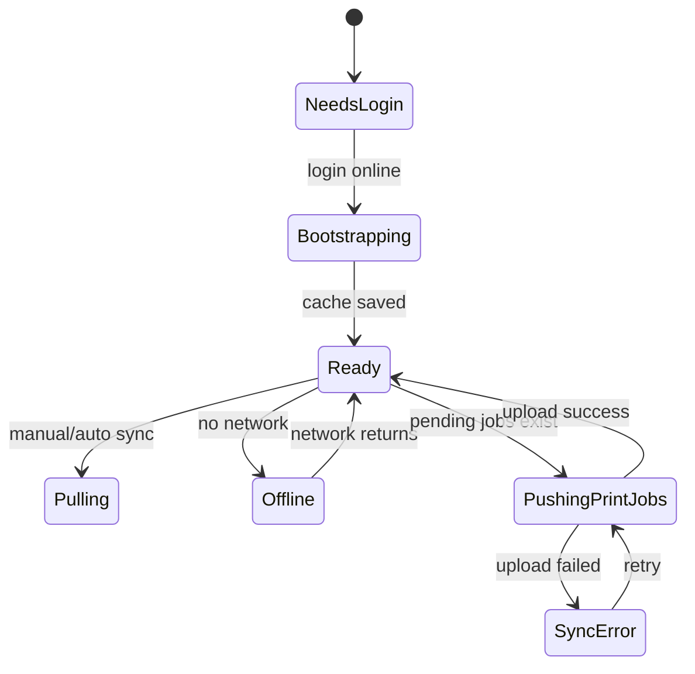

# API And Sync Design / API 与同步设计

## API Groups / API 分组

| Group | Endpoints / 端点 | Purpose / 用途 |
| --- | --- | --- |
| Auth | `/auth/login`, `/auth/refresh`, `/auth/logout` | Login and token lifecycle. |
| Site Admin | `/site/companies`, `/site/audit-log`, `/site/health` | Platform management. |
| Company Admin | `/company/outlets`, `/company/users`, `/company/products`, `/company/categories` | Tenant admin. |
| Images | `/company/products/:productId/image` | Upload or replace product images from Product Detail. |
| Sync | `/sync/bootstrap`, `/sync/pull`, `/sync/push-print-jobs`, `/sync/device-printer` | Mobile cache, printer registry sync, and offline upload. |

## Authentication / 认证

- Access token: short lived JWT.
- Refresh token: longer lived and stored securely on the mobile device.
- Web admin session can use HTTP-only cookies or token storage depending on final implementation.
- Disabled users and disabled companies cannot refresh tokens.
- Mobile login supports Company Admin and Outlet User email/password.
- Mobile session remains active until logout as long as refresh token is valid.

## Mobile Bootstrap / 移动端首次同步

`POST /sync/bootstrap` returns the full initial cache after login:

- company profile
- current user and role
- assigned outlets
- categories
- products
- outlet product availability
- label templates
- image metadata and image download URLs
- server sync cursor

First login requires network. After bootstrap, the Android app can work offline from SQLite.

## Incremental Pull / 增量拉取

`GET /sync/pull?cursor=...` returns changed records since the device cursor.

Rules:

- Server-owned records overwrite local cached copies.
- Deleted or disabled records are sent as tombstones or status changes.
- Mobile stores the new cursor only after the transaction succeeds.
- Product images download separately and can retry without blocking core data sync.

## Push Print Jobs / 上传打印记录

`POST /sync/push-print-jobs` uploads device-created PrintJob records.

Rules:

- Each PrintJob has a client-generated `clientJobId`.
- Upload is idempotent: repeated upload of the same `clientJobId` does not create duplicates.
- PrintJob stores product/outlet snapshots used at print time.
- PrintJob stores `labelType`, `labelSize`, `printerName`, and `printerMacAddress` snapshots so monthly sticker totals can be grouped by outlet and label type.
- Device sync stores the latest selected printer name and MAC/Bluetooth identifier for support and audit visibility.
- Failed uploads remain in the local pending queue with an error message.

## Device Printer Sync / 设备打印机同步

Adding, removing, or changing the selected printer must be online.

Rules:

- Mobile records printer display name and MAC address when available.
- If MAC address is unavailable, mobile records Bluetooth identifier plus printer display name.
- API updates the company `Device` printer registry.
- API creates audit event when printer identity changes.
- Actual label printing does not require network after a printer has been selected locally.

## Conflict Handling / 冲突处理

- Cloud master data wins for server-owned records.
- Mobile does not edit master Product, ProductCategory, Outlet, or OutletProduct while offline.
- Outlet custom products may be queued locally, then assigned server IDs after upload.
- If a custom product conflicts with a server product code, API rejects it and returns a user-readable conflict.

## Sync State Machine / 同步状态

