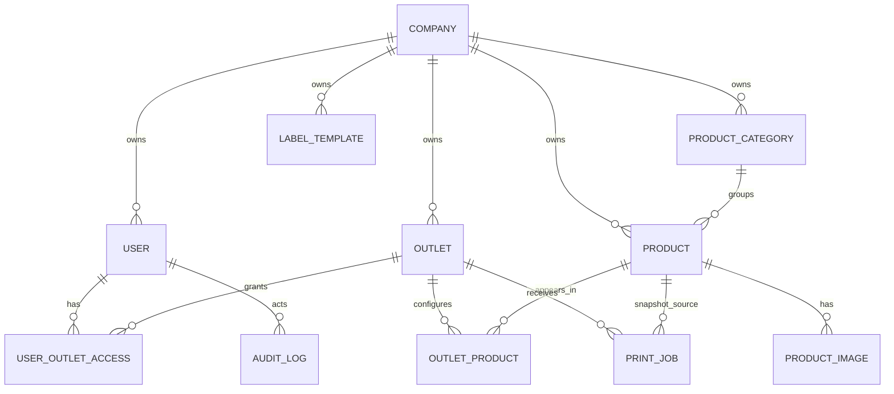

# Cloud Data Model / 云端数据模型

## Common Fields / 通用字段

Every cloud-owned table should include:

- `id`: UUID primary key.
- `companyId`: tenant boundary where applicable.
- `status`: active, inactive, disabled, archived.
- `createdAt`, `updatedAt`, `deletedAt`.
- `createdByUserId`, `updatedByUserId`.
- `syncVersion`: monotonic version or timestamp used by mobile pull sync.

每个云端表都应有 UUID 主键、公司边界、状态、创建/更新时间、软删除字段和同步版本字段。

## Core Tables / 核心表

| Table | Purpose / 用途 | Key Rules / 关键规则 |
| --- | --- | --- |
| Company | Tenant root. / 租户根记录 | Company code unique. Disabled company blocks login/sync. Stores max printer connections; `null` means unlimited. |
| User | Login identity. / 登录账号 | Email unique. Role controls permission. |
| UserOutletAccess | Outlet access mapping. / 用户门店权限 | Outlet User must have at least one outlet. |
| Outlet | Shop or kitchen. / 门店或中央厨房 | One `code` is unique within company. Do not maintain separate short code unless a future integration requires it. |
| ProductCategory | Category and prefix. / 分类与编码前缀 | `codePrefix` unique within company. |
| Product | Master or outlet product. / 主产品或门店自定义产品 | `productCode` unique within company. |
| OutletProduct | Product availability per outlet. / 门店可用产品 | `active` controls visibility with Product.active. |
| ProductImage | Image metadata. / 产品图片资料 | Uploaded from Product Detail. Images cached by mobile; not printed. |
| LabelTemplate | Label layout. / 标签模板 | Versioned layout JSON. |
| PrintJob | Print attempt snapshot. / 打印记录快照 | Device-created, uploaded idempotently. Store `labelType`, `labelSize`, `printerName`, and `printerMacAddress` snapshots for reporting. |
| AuditLog | Append-only audit. / 只追加审计日志 | No updates or deletes in normal app flow. |
| Device | Mobile device registration. / 移动设备注册 | Tracks last sync, app version, selected printer name, and printer MAC/Bluetooth identifier. Counts against company printer quota when active and printer identity is present. |
| SyncCursor | Optional device cursor. / 可选设备同步游标 | Stores last successful pull/push state. |

## Relationships / 关系

## Product Code Rules / 产品编码规则

- `productCode = codePrefix + 3-digit sequence`.
- Product codes are stable and unique within company.
- Category prefix changes apply to future products by default.
- Renumbering existing products requires preview, conflict check, explicit confirmation, and audit log.
- PrintJob keeps product code/name snapshots; old history is never rewritten.

## Tenant Boundary / 租户边界

All Company Admin and Outlet User queries must include `companyId`. Site Admin can query across companies only from Site Admin APIs. Cross-company access must be blocked at service and database query layers.
