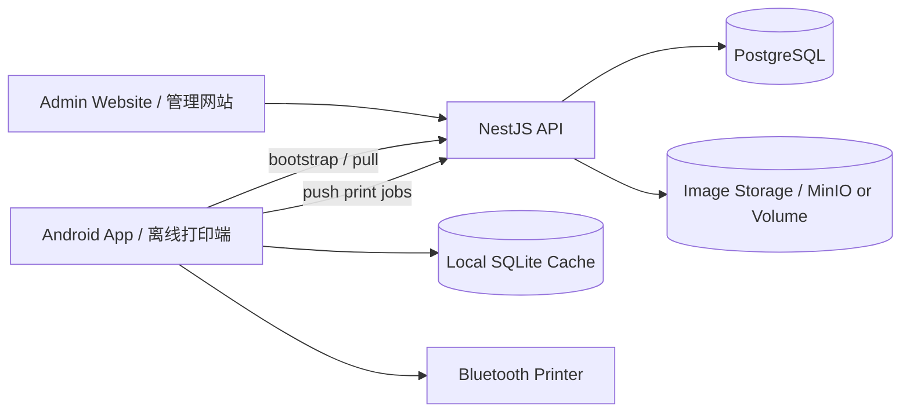

# Cloud System Overview / 云端系统总览

## Purpose / 目标

JR Shelf Life Label App will evolve from a standalone Android app into an offline-first cloud-backed system. The cloud platform owns company master data, while Android devices keep a local cache so outlet staff can still search, preview, and print shelf-life labels without network access.

JR Shelf Life Label App 将从 Android standalone app 演进为离线优先、云端同步的系统。云端负责公司主数据，Android 设备保留本地缓存，让门店员工在无网络时仍然可以搜索、预览和打印保质期标签。

## Recommended Stack / 推荐技术栈

- Admin website / 管理网站: Next.js, React, TypeScript.
- Backend API / 后端 API: NestJS, TypeScript.
- Database / 数据库: PostgreSQL with Prisma migrations.
- Mobile app / 移动端: existing React Native / Expo app, upgraded to SQLite cache and sync.
- Deployment / 部署: Docker Compose on one server, with persistent PostgreSQL volume and scheduled backups.
- Reverse proxy / 反向代理: Caddy for automatic HTTPS, or Nginx if manual certificate control is preferred.

## Roles / 角色

| Role | English Responsibility | 中文职责 |
| --- | --- | --- |
| Site Admin | Operates the SaaS platform, companies, backups, and global audit. | 管理平台、公司、备份和全局审计。 |
| Company Admin | Manages one company, outlets, users, master products, categories, images, and outlet availability. | 管理单一公司的门店、用户、主产品、分类、图片和门店可用产品。 |
| Outlet User | Uses Android app to select outlet, print labels, and sync print jobs. | 使用 Android app 选择门店、打印标签并同步打印记录。 |

## Data Ownership / 数据归属

Cloud-owned data is edited on the website and pulled by mobile devices: Company, User, Outlet, ProductCategory, Product, OutletProduct, LabelTemplate, and ProductImage.

云端拥有并通过网站编辑的数据包括：Company、User、Outlet、ProductCategory、Product、OutletProduct、LabelTemplate 和 ProductImage。移动端从云端拉取这些数据并缓存。

Device-owned data is created on Android first and uploaded later: PrintJob, printer preference, device profile, sync queue, and diagnostic logs.

设备拥有并先在 Android 本地创建的数据包括：PrintJob、打印机偏好、设备信息、同步队列和诊断日志。

## Online/Offline Boundary / 在线与离线边界

- First login requires network so the device can authenticate and bootstrap the SQLite cache.
- After bootstrap, outlet staff can view products, search, scan product codes, calculate expiry, preview labels, print labels, and save print jobs offline.
- Company master data edits require the admin website and network access.
- Print jobs created offline are queued with client-generated IDs and uploaded idempotently when the device reconnects.
- Images are cached locally after sync; products without cached images remain printable with a text-focused fallback.

## High-Level Flow / 高层流程

