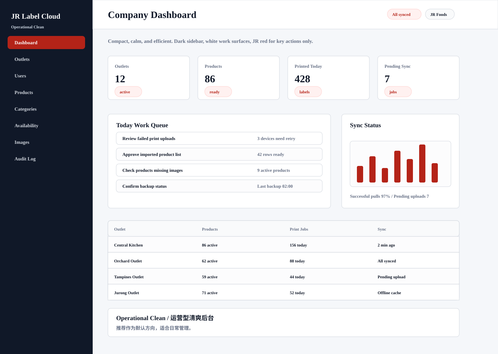
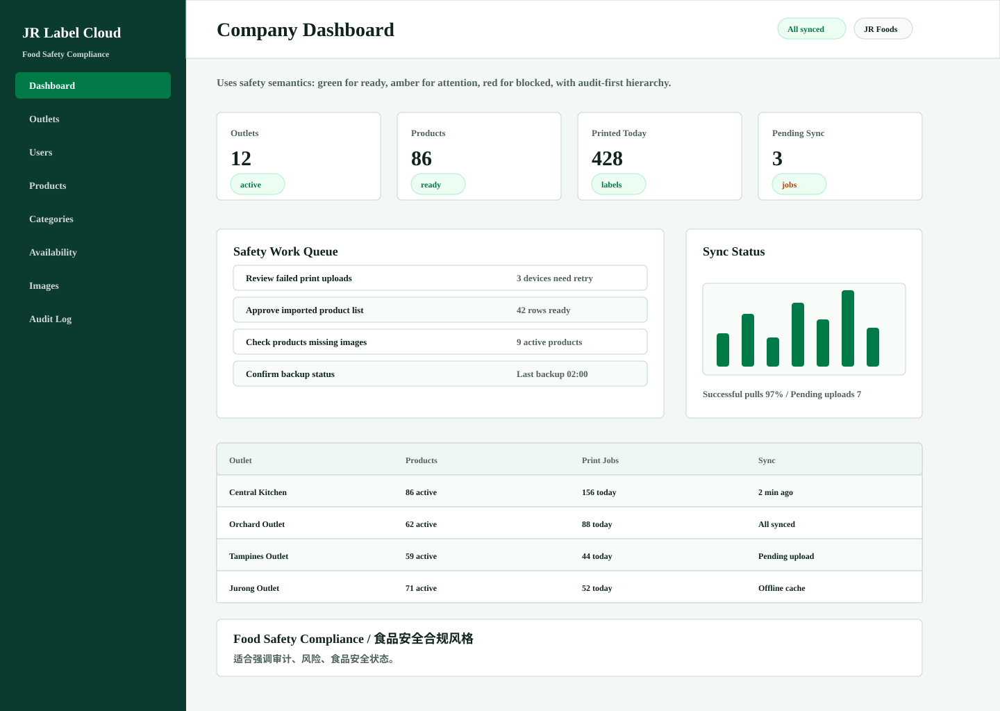
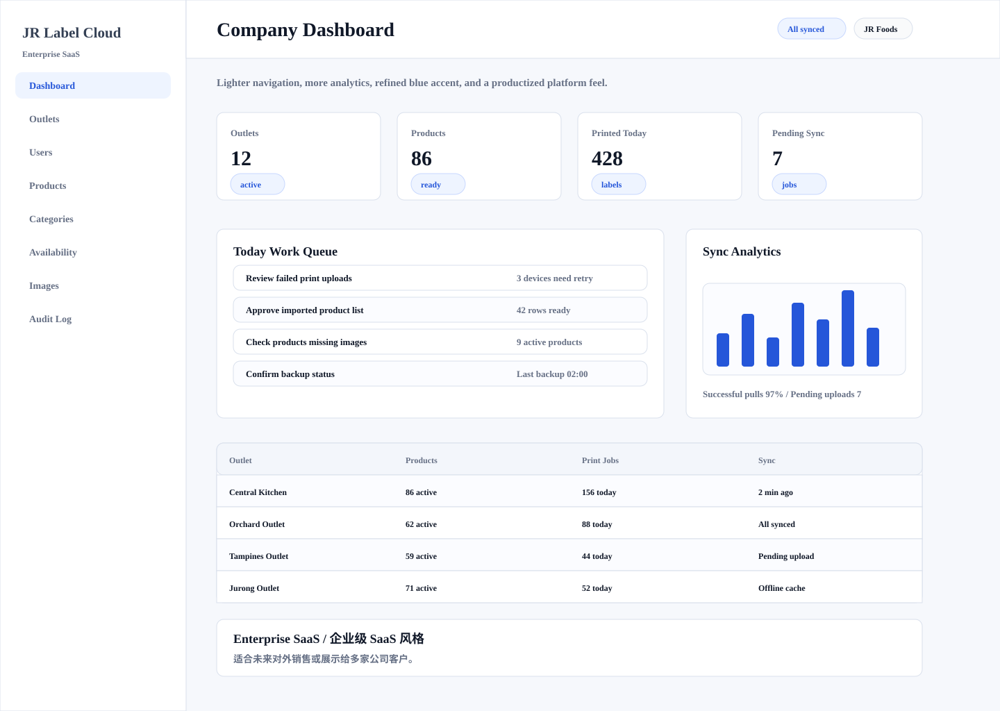
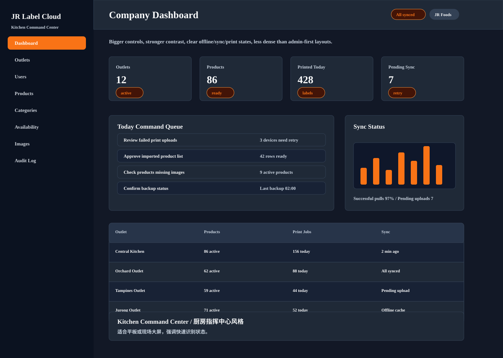
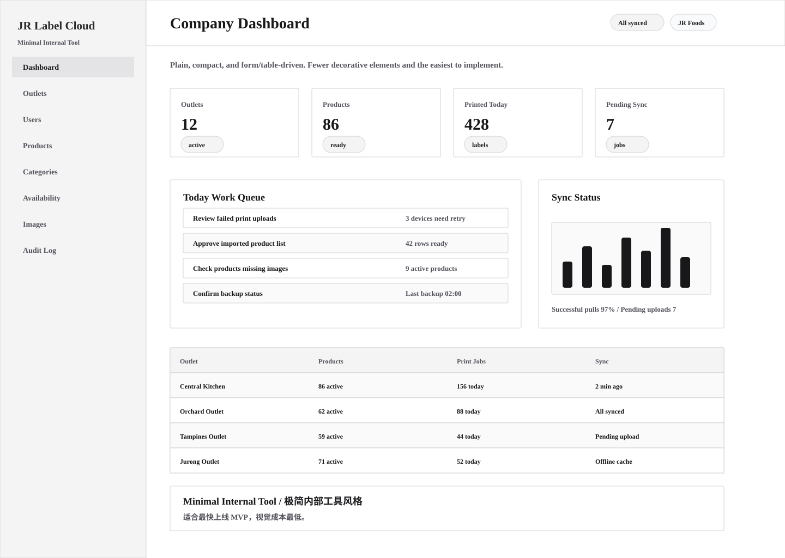

# Website Style Options / 网站风格方案

This document compares five possible visual directions for the JR Label Cloud admin website.

本文档对比 JR Label Cloud 后台网站的五种可选视觉方向。技术栈保持：Next.js + TypeScript admin website, NestJS + TypeScript API, Prisma, PostgreSQL, Python scripts where useful.

## HTML Preview / HTML 预览

Open the style gallery directly:

[docs/wireframes/style-options/index.html](wireframes/style-options/index.html)

## Options / 方案

### Operational Clean / 运营型清爽后台

- Best for: Default recommendation for daily admin work.
- 适合场景：推荐作为默认方向，适合日常管理。
- Direction: Compact, calm, and efficient. Dark sidebar, white work surfaces, JR red for key actions only.
- 设计方向：紧凑、清楚、效率优先。深色侧栏、白色工作区，只在关键操作使用 JR red。
- HTML: [Open Operational Clean](wireframes/style-options/operational-clean.html)

### Food Safety Compliance / 食品安全合规风格

- Best for: Best when audit readiness and risk visibility are the main story.
- 适合场景：适合强调审计、风险、食品安全状态。
- Direction: Uses safety semantics: green for ready, amber for attention, red for blocked, with audit-first hierarchy.
- 设计方向：使用食品安全语义色：绿色可用、琥珀需注意、红色阻断，并突出审计信息。
- HTML: [Open Food Safety Compliance](wireframes/style-options/food-safety-compliance.html)

### Enterprise SaaS / 企业级 SaaS 风格

- Best for: Best when the platform needs to feel polished for external customers.
- 适合场景：适合未来对外销售或展示给多家公司客户。
- Direction: Lighter navigation, more analytics, refined blue accent, and a productized platform feel.
- 设计方向：浅色导航、更多分析模块、蓝色重点色，看起来更像成熟 SaaS 产品。
- HTML: [Open Enterprise SaaS](wireframes/style-options/enterprise-saas.html)

### Kitchen Command Center / 厨房指挥中心风格

- Best for: Best for tablet or operations wall displays where status must be obvious.
- 适合场景：适合平板或现场大屏，强调快速识别状态。
- Direction: Bigger controls, stronger contrast, clear offline/sync/print states, less dense than admin-first layouts.
- 设计方向：按钮更大、对比更强，同步和打印状态更醒目，信息密度比后台低。
- HTML: [Open Kitchen Command Center](wireframes/style-options/kitchen-command-center.html)

### Minimal Internal Tool / 极简内部工具风格

- Best for: Fastest MVP build with low visual overhead.
- 适合场景：适合最快上线 MVP，视觉成本最低。
- Direction: Plain, compact, and form/table-driven. Fewer decorative elements and the easiest to implement.
- 设计方向：朴素紧凑，以表格和表单为主，装饰最少，开发最快。
- HTML: [Open Minimal Internal Tool](wireframes/style-options/minimal-internal-tool.html)

## Recommendation / 推荐

Recommended direction: **Operational Clean + Food Safety Compliance status colors**.

推荐方向：**Operational Clean 的整体布局 + Food Safety Compliance 的状态颜色语义**。

Reason / 原因：

- Daily admin pages need compact tables and forms.
- Food safety, sync, print, and audit states need very clear color meaning.
- It is easier to implement consistently in Next.js without making the UI decorative.

日常后台页面需要紧凑清楚的表格和表单；食品安全、同步、打印和审计状态需要很明确的颜色语义；这个组合也最容易在 Next.js 中稳定实现。
