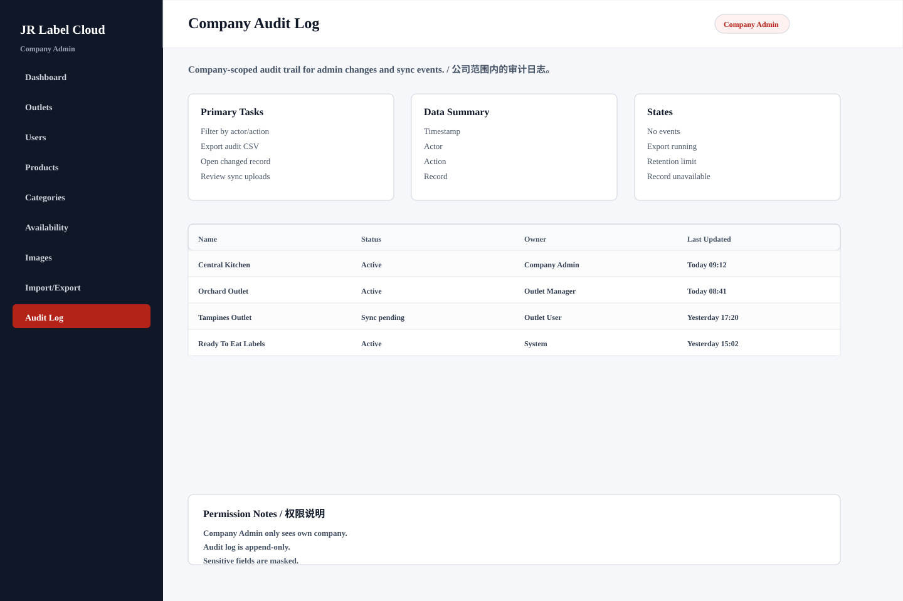

# Company Audit Log

## Purpose / 页面目的

Company-scoped audit trail for admin changes and sync events. / 公司范围内的审计日志。

## Roles Allowed / 可访问角色

- Company Admin

## Main Actions / 主要操作

- Filter by actor/action
- Export audit CSV
- Open changed record
- Review sync uploads

## Data Shown / 显示数据

- Timestamp
- Actor
- Action
- Record
- Before/after summary

## Empty/Error/Loading States / 空状态、错误、加载状态

- No events
- Export running
- Retention limit
- Record unavailable

## Permissions / 权限规则

- Company Admin only sees own company.
- Audit log is append-only.
- Sensitive fields are masked.
