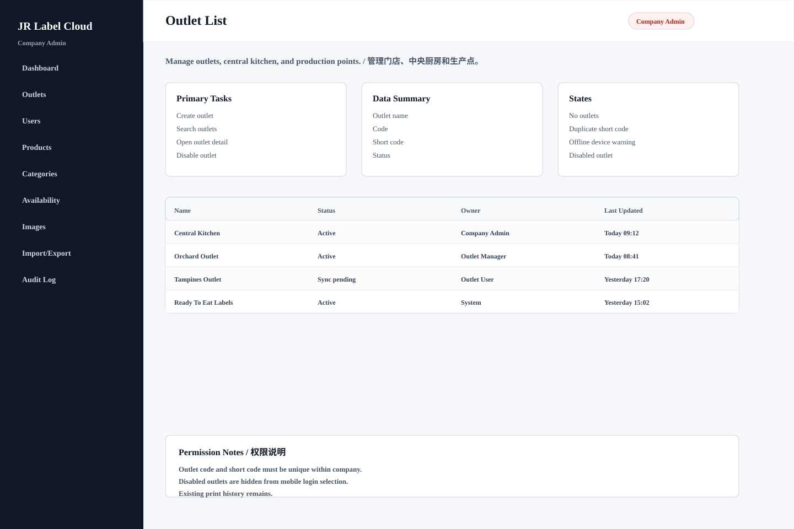

# Outlet List

## Purpose / 页面目的

Manage outlets, central kitchen, and production points. / 管理门店、中央厨房和生产点。

## Roles Allowed / 可访问角色

- Company Admin

## Main Actions / 主要操作

- Create outlet
- Search outlets
- Open outlet detail
- Disable outlet

## Data Shown / 显示数据

- Outlet name
- Code
- Status
- Last device sync

## Empty/Error/Loading States / 空状态、错误、加载状态

- No outlets
- Duplicate outlet code
- Offline device warning
- Disabled outlet

## Permissions / 权限规则

- Outlet code must be unique within company.
- Disabled outlets are hidden from mobile login selection.
- Existing print history remains.
