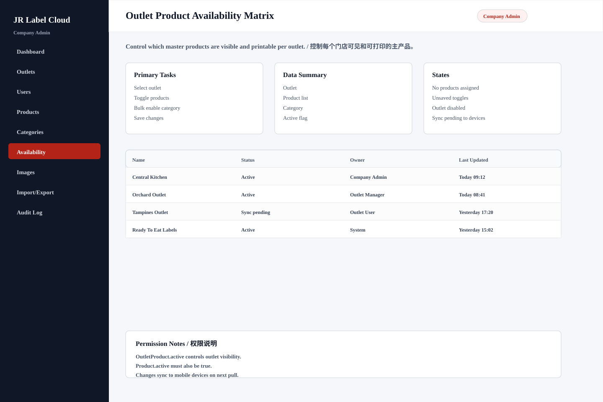

# Outlet Product Availability Matrix

## Purpose / 页面目的

Control which master products are visible and printable per outlet. / 控制每个门店可见和可打印的主产品。

## Roles Allowed / 可访问角色

- Company Admin

## Main Actions / 主要操作

- Select outlet
- Toggle products
- Bulk enable category
- Save changes

## Data Shown / 显示数据

- Outlet
- Product list
- Category
- Active flag
- Sync status

## Empty/Error/Loading States / 空状态、错误、加载状态

- No products assigned
- Unsaved toggles
- Outlet disabled
- Sync pending to devices

## Permissions / 权限规则

- OutletProduct.active controls outlet visibility.
- Product.active must also be true.
- Changes sync to mobile devices on next pull.
