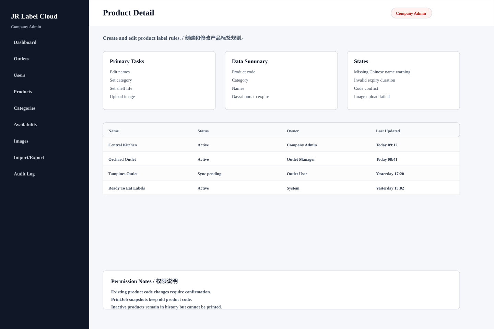

# Product Detail

## Purpose / 页面目的

Create and edit product label rules. / 创建和修改产品标签规则。

## Roles Allowed / 可访问角色

- Company Admin

## Main Actions / 主要操作

- Edit names
- Set category
- Set shelf life
- Upload image
- Activate/deactivate

## Data Shown / 显示数据

- Product code
- Category
- Names
- Days/hours to expire
- Storage method
- Image

## Empty/Error/Loading States / 空状态、错误、加载状态

- Missing Chinese name warning
- Invalid expiry duration
- Code conflict
- Image upload failed

## Permissions / 权限规则

- Existing product code changes require confirmation.
- PrintJob snapshots keep old product code.
- Inactive products remain in history but cannot be printed.
