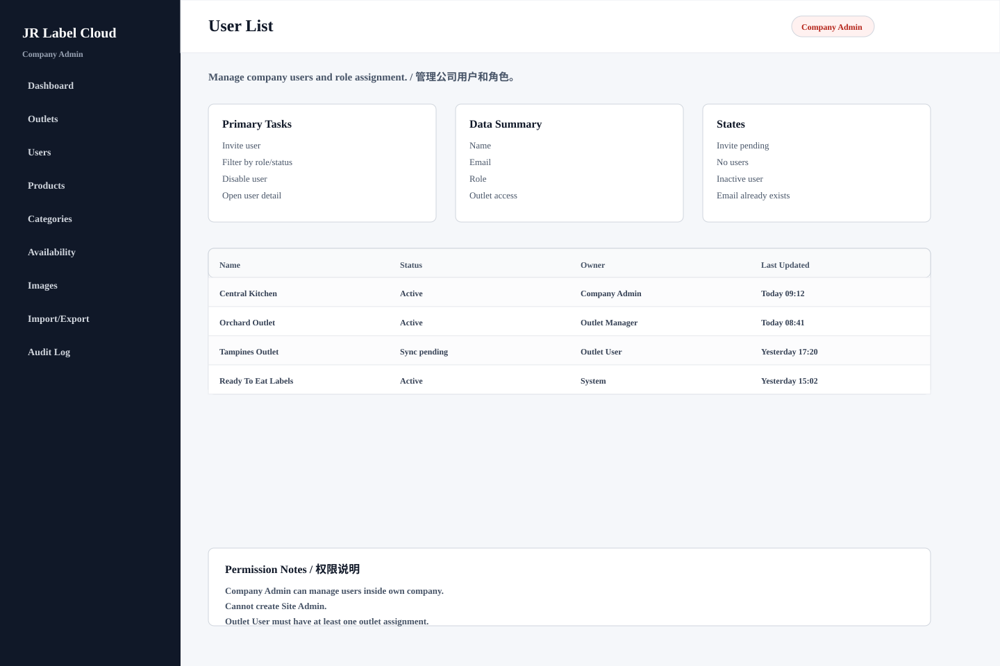

# User List

## Purpose / 页面目的

Manage company users and role assignment. / 管理公司用户和角色。

## Roles Allowed / 可访问角色

- Company Admin

## Main Actions / 主要操作

- Invite user
- Filter by role/status
- Disable user
- Open user detail

## Data Shown / 显示数据

- Name
- Email
- Role
- Outlet access
- Last login

## Empty/Error/Loading States / 空状态、错误、加载状态

- Invite pending
- No users
- Inactive user
- Email already exists

## Permissions / 权限规则

- Company Admin can manage users inside own company.
- Cannot create Site Admin.
- Outlet User must have at least one outlet assignment.
