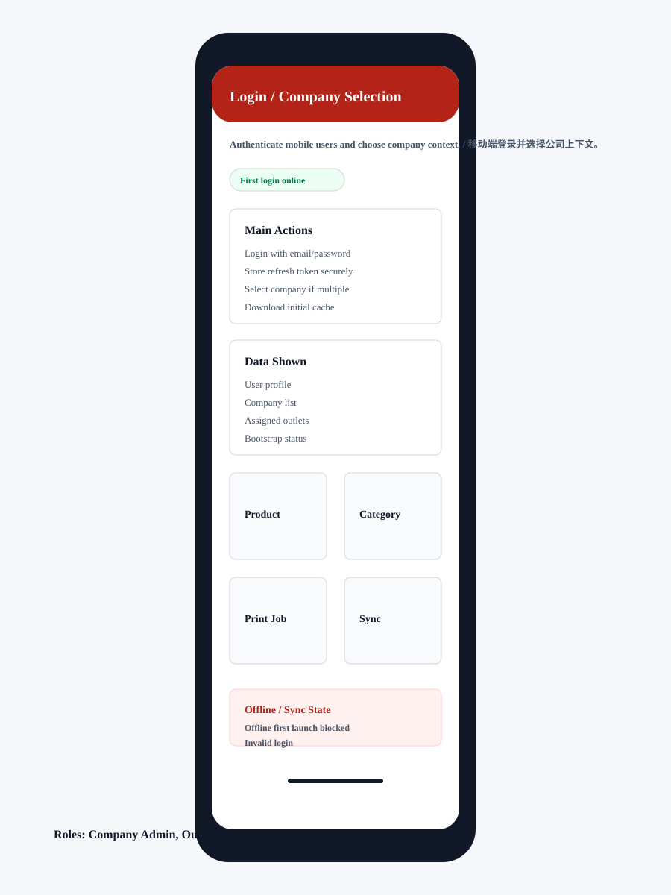

# Login / Company Selection

## Purpose / 页面目的

Authenticate mobile users and choose company context. / 移动端登录并选择公司上下文。

## Roles Allowed / 可访问角色

- Company Admin
- Outlet User

## Main Actions / 主要操作

- Login with email/password
- Store refresh token securely
- Select company if multiple
- Download initial cache

## Data Shown / 显示数据

- User profile
- Company list
- Assigned outlets
- Bootstrap status

## Empty/Error/Loading States / 空状态、错误、加载状态

- Offline first launch blocked
- Invalid login
- Company disabled
- Bootstrap complete

## Permissions / 权限规则

- Outlet User sees assigned outlets only.
- Tokens stored in SecureStore.
- First login requires network.
