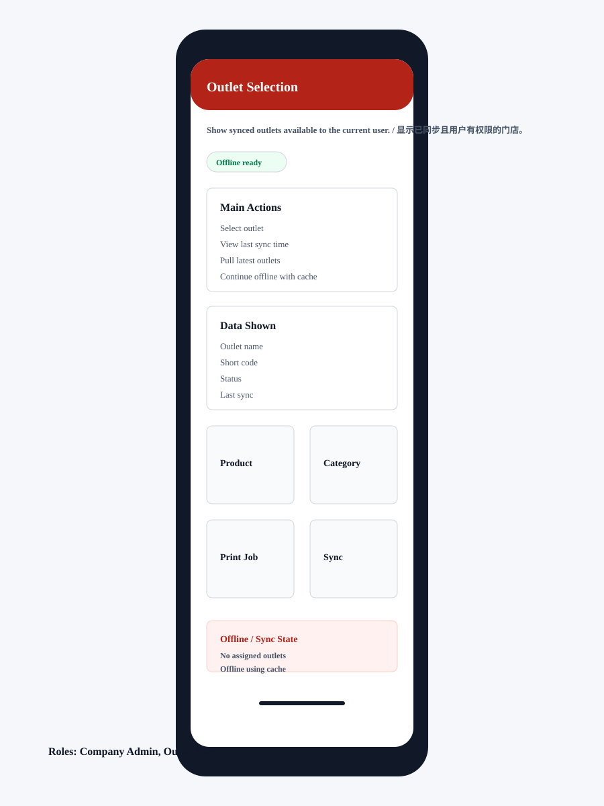

# Outlet Selection

## Purpose / 页面目的

Show synced outlets available to the current user. / 显示已同步且用户有权限的门店。

## Roles Allowed / 可访问角色

- Company Admin
- Outlet User

## Main Actions / 主要操作

- Select outlet
- View last sync time
- Pull latest outlets
- Continue offline with cache

## Data Shown / 显示数据

- Outlet name
- Short code
- Status
- Last sync

## Empty/Error/Loading States / 空状态、错误、加载状态

- No assigned outlets
- Offline using cache
- Outlet disabled after sync
- Sync failed

## Permissions / 权限规则

- Only assigned outlets appear.
- Disabled outlets are hidden after sync.
- Last selected outlet can be remembered locally.
