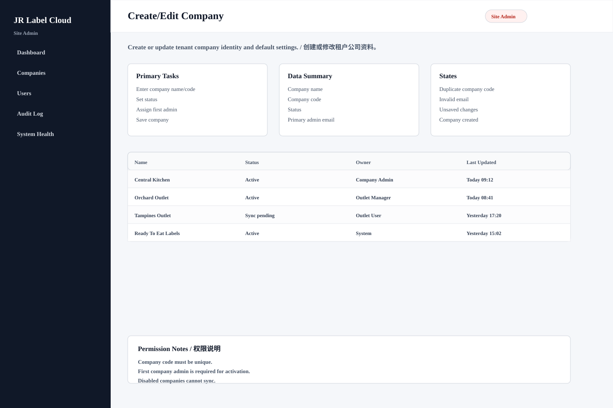

# Create/Edit Company

## Purpose / 页面目的

Create or update tenant company identity and default settings. / 创建或修改租户公司资料。

## Roles Allowed / 可访问角色

- Site Admin

## Main Actions / 主要操作

- Enter company name/code
- Set status
- Assign first admin
- Save company

## Data Shown / 显示数据

- Company name
- Company code
- Status
- Primary admin email

## Empty/Error/Loading States / 空状态、错误、加载状态

- Duplicate company code
- Invalid email
- Unsaved changes
- Company created

## Permissions / 权限规则

- Company code must be unique.
- First company admin is required for activation.
- Disabled companies cannot sync.
