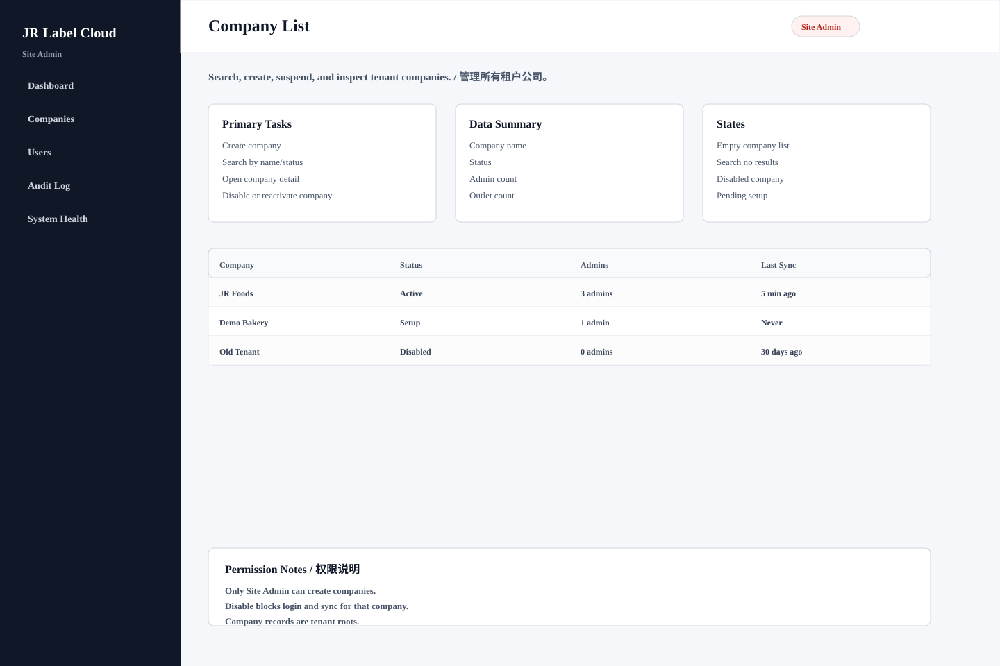

# Company List

## Purpose / 页面目的

Search, create, suspend, and inspect tenant companies. / 管理所有租户公司。

## Roles Allowed / 可访问角色

- Site Admin

## Main Actions / 主要操作

- Create company
- Search by name/status
- Open company detail
- Disable or reactivate company

## Data Shown / 显示数据

- Company name
- Status
- Admin count
- Outlet count
- Last sync

## Empty/Error/Loading States / 空状态、错误、加载状态

- Empty company list
- Search no results
- Disabled company
- Pending setup

## Permissions / 权限规则

- Only Site Admin can create companies.
- Disable blocks login and sync for that company.
- Company records are tenant roots.
