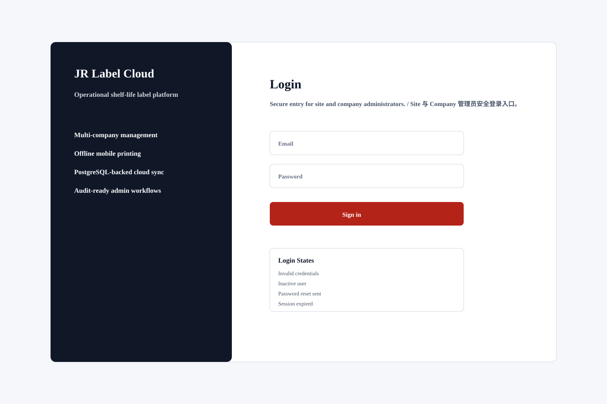

# Login

## Purpose / 页面目的

Secure entry for site and company administrators. / Site 与 Company 管理员安全登录入口。

## Roles Allowed / 可访问角色

- Site Admin
- Company Admin

## Main Actions / 主要操作

- Enter email and password
- Select company after login if needed
- Request password reset
- Show account lock warning

## Data Shown / 显示数据

- Email
- Password
- Remember session option
- Authentication error

## Empty/Error/Loading States / 空状态、错误、加载状态

- Invalid credentials
- Inactive user
- Password reset sent
- Session expired

## Permissions / 权限规则

- Only active users can login.
- Role determines post-login dashboard.
- Outlet users use the mobile app login by default.
